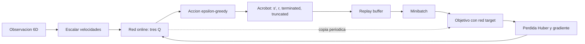
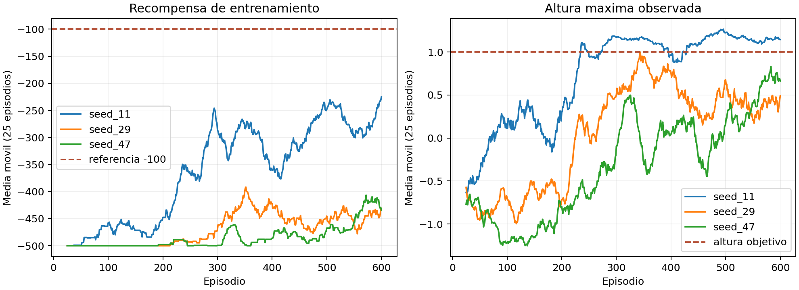
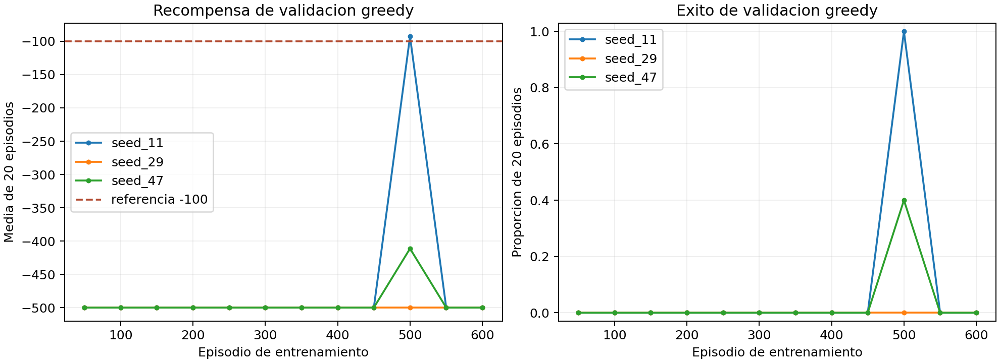

# Acrobot-v1 con Deep Q-Network

**U3 Taller 2 | Simulacion de aprendizaje por refuerzo**

La pregunta no es si un brazo puede moverse, sino si puede **coordinar torque y
velocidad para elevar su extremo libre** antes del limite de 500 pasos.
Implementamos DQN en PyTorch y lo comparamos con una politica aleatoria bajo las
mismas condiciones de prueba. El experimento usa la recompensa original del
entorno; la altura de la punta solo es una medida de diagnostico.

El recorrido didactico, la auditoria ejecutable y las figuras estan en
[Acrobot_DQN_U3_Taller2.ipynb](Acrobot_DQN_U3_Taller2.ipynb). El entrenamiento
reutilizable y verificable esta en [acrobot_dqn.py](acrobot_dqn.py).

## 1. Problema como proceso de decision

Acrobot-v1 modela dos eslabones unidos. El primero esta fijo en un extremo y
solo la articulacion entre ambos recibe torque. La meta es que la punta libre
supere la altura relativa `1`. No fue uno de los entornos trabajados en las
actividades previas del repositorio (CartPole y MountainCar).

| Elemento | Definicion exacta | Implicacion |
|---|---|---|
| Observacion | `Box(shape=(6,), dtype=float32)` | Entrada numerica de seis componentes. |
| Componentes 0-3 | `cos(theta1)`, `sin(theta1)`, `cos(theta2)`, `sin(theta2)`; cada una en `[-1,1]` | Capturan orientacion sin discontinuidad angular. |
| Componentes 4-5 | Velocidades angulares en `[-4pi,4pi]` y `[-9pi,9pi]` | Se dividen por `4pi` y `9pi` antes de la red. |
| Acciones | `Discrete(3)`: `0` torque `-1`, `1` torque `0`, `2` torque `+1` | La red entrega tres Q-valores. |
| Recompensa | `-1` en cada paso que no llega a la meta; `0` al llegar | Una recompensa menos negativa significa resolver mas rapido. |
| Terminacion | `-cos(theta1)-cos(theta1+theta2)>1` | Se acaba por exito y se anula el bootstrap. |
| Truncamiento | Limite de 500 pasos | Se cierra el episodio, pero no se etiqueta como estado terminal del MDP. |

La observacion inicial es casi vertical hacia abajo. El agente debe aprender a
bombear energia mediante oscilaciones; aplicar un torque constante no basta.
Como el estado ya contiene velocidades, **no se apilan frames**. Una CNN tampoco
es pertinente: no hay pixeles. Para interpretar los fallos, reconstruimos
`h=-cos(theta1)-cos(theta1+theta2)` a partir de la observacion. La altura no
entra en la recompensa ni se anade a la entrada de la red.

## 2. DQN implementado



La red online es `Linear(6,128) -> ReLU -> Linear(128,64) -> ReLU ->
Linear(64,3)`. Tiene **9 347 parametros** entrenables. El modelo es deliberadamente
pequeno: el vector de estado es compacto y estructurado. La asimetria entre
128 y 64 neuronas reduce la representacion antes de las tres acciones.

Para una transicion `(s,a,r,s')`, el objetivo es

`y = r + gamma * (1 - terminated) * max_a' Q_target(s',a')`.

La red online minimiza `Huber(Q_online(s,a), y)`. En `terminated=True`, `y=r`.
En `truncated=True`, conservamos el bootstrap porque el limite de tiempo es
externo a la dinamica. El episodio siempre finaliza cuando cualquiera de las
dos banderas es verdadera. La red target se copia de la online periodicamente,
sin recibir gradientes directamente.

| Hiperparametro | Valor | Motivo |
|---|---:|---|
| Episodios | 600 por semilla | Dar tiempo a descubrir una meta poco frecuente. |
| `gamma` | 0.99 | Favorecer la coordinacion de varios pasos. |
| Adam `lr` | 0.001 | Tasa inicial moderada; se evalua su estabilidad. |
| Minibatch | 64 | Compromiso entre ruido y costo en CPU. |
| Replay | 100 000 transiciones | Mezclar experiencias temporalmente separadas. |
| Calentamiento | 1 000 pasos | No aprender de un buffer casi vacio. |
| Entrenar | Cada 4 pasos | Reducir costo y correlacion entre actualizaciones. |
| Sincronizar target | Cada 2 000 pasos | Mantener objetivo relativamente estable. |
| `epsilon` | Lineal de 1.0 a 0.05 en 80 000 pasos | Explorar al inicio y conservar exploracion residual. |
| Perdida / gradiente | Huber / norma maxima 10 | Acotar el efecto de errores TD grandes. |

La funcion de recompensa no se modifica. Esto permite atribuir cualquier
mejora al aprendizaje de la tarea real, no a una recompensa disenada a mano.

## 3. Protocolo experimental

1. Entrenar tres modelos independientes con semillas `11`, `29` y `47`.
2. Cada 50 episodios, evaluar la politica greedy en 20 episodios con semillas
   de validacion `100000..100019`. Guardar el checkpoint con mejor recompensa
   media. Se conserva tambien la red del ultimo episodio para detectar colapsos.
3. Evaluar cada mejor checkpoint y una politica aleatoria en **las mismas 50
   semillas de prueba** `200000..200049`, distintas de validacion. Reportar
   recompensa media, dispersion, mediana, tasa de exito, pasos y altura maxima.
4. Graficar recompensa de entrenamiento (media movil de 25 episodios), altura
   maxima y evaluacion greedy. No seleccionar el mejor resultado de prueba.

La referencia oficial del entorno es recompensa media `-100`; no se interpreta
como un exito garantizado. Las mediciones de prueba son las que respaldan la
conclusion, no la curva exploratoria de entrenamiento.

## 4. Resultados

Se ejecutaron 600 episodios por semilla en CPU. La tabla corresponde a **50
episodios de prueba independientes por agente**, con las mismas semillas para
la politica aleatoria y los tres DQN. `h` es la altura maxima media por
episodio; no es una recompensa adicional.

| Politica | Checkpoint (episodio) | Recompensa media ± DE | Mediana | Exito | Pasos medios | `h` maxima media |
|---|---:|---:|---:|---:|---:|---:|
| Aleatoria | — | -500.00 ± 0.00 | -500 | 0/50 (0%) | 500.00 | -0.397 |
| DQN, semilla 11 | 500 | **-94.88 ± 22.95** | -88 | **50/50 (100%)** | 95.88 | 1.208 |
| DQN, semilla 29 | 50 | -500.00 ± 0.00 | -500 | 0/50 (0%) | 500.00 | -1.226 |
| DQN, semilla 47 | 500 | -366.16 ± 114.61 | -321 | 31/50 (62%) | 366.78 | 0.006 |

La media de recompensa de los tres DQN, dando el mismo peso a cada semilla, fue
`-320.35`; la tasa conjunta de exito fue `81/150 = 54%`. Este agregado es
**descriptivo, no prueba de robustez**: entre modelos hay mucha variacion.
Solo la semilla 11 supera el umbral de referencia `-100`. La semilla 47
aprendio una politica parcialmente efectiva; la 29 no generalizo a una
politica greedy exitosa. La politica aleatoria no logro ningun exito.



La curva anterior muestra el aprendizaje **durante exploracion**. La siguiente
es evaluacion greedy y revela que, aunque la recompensa de entrenamiento
mejoraba, las politicas llegaron a degradarse de nuevo:



En validacion, la semilla 11 alcanzo recompensa `-92.75` y exito `20/20` en
el episodio 500; la 47 llego a `-411.4` y `8/20`. En el episodio 600 **las
tres redes finales** volvieron a `-500` y `0/20`. Por eso el resultado de
prueba usa el mejor checkpoint de validacion, elegido antes de mirar la prueba.

## 5. Reflexion sobre los resultados

El experimento demuestra **posibilidad, no confiabilidad**. El mismo DQN y los
mismos hiperparametros producen una politica que resuelve consistentemente
(semilla 11), otra que falla a menudo (47) y otra que no resuelve (29). El
resultado de la semilla 11 es fuerte en las 50 condiciones de prueba, pero
seria incorrecto presentar ese caso aislado como desempeno tipico.

El fracaso de la semilla 29 es instructivo: durante entrenamiento hubo 159
episodios exitosos, pero la politica greedy guardada nunca obtuvo un exito en
validacion ni prueba. **Llegar por exploracion no equivale a haber aprendido
que acciones repetir.** Su altura maxima media de prueba fue incluso peor que
la de la politica aleatoria. En la semilla 47, 31 exitos conviven con una
recompensa media de `-366.16`: muchos fracasos alcanzan los 500 pasos y pesan
mucho en el promedio. La altura media cercana a cero mezcla episodios que
llegan al umbral con otros que apenas elevan la punta.

La limitacion estructural nace de la recompensa: casi todas las transiciones
tempranas valen `-1`; el agente recibe poca informacion sobre el torque que
acumula energia para una meta lejana. DQN ademas combina bootstrap, seleccion
por maximo y datos off-policy, por lo que puede ser sensible a inicializacion
y distribucion de replay. El colapso al final de las semillas 11 y 47 muestra
que el entrenamiento no fue monotono. El checkpoint por validacion rescata
politicas utiles, pero no elimina la inestabilidad. Un siguiente experimento
controlado podria comparar Double DQN o tasas de aprendizaje menores con las
mismas semillas y presupuesto; no se atribuyen esas mejoras a este trabajo.

## 6. Lo mas dificil

El mayor reto conceptual fue aceptar que una curva de entrenamiento ascendente
no garantiza una buena politica: el agente actua con epsilon y puede acertar
por azar. Para separarlo, se implemento evaluacion greedy periodica, 50
semillas de prueba reservadas y un baseline aleatorio emparejado. Lo mas
dificil tecnicamente fue tratar correctamente `terminated` frente a
`truncated` en el objetivo de Bellman y evitar que la red online persiga un
objetivo que cambia cada paso; una prueba verifica que un terminal real no
usa estimacion futura. Tambien hubo que diagnosticar la gran sensibilidad
a la semilla y conservar checkpoints intermedios porque las tres redes
finales resultaron peores. IMOA no tenia GPU disponible ni `pytest`, de modo
que el entrenamiento se hizo en CPU y las pruebas usan `unittest`.

## 7. Como reproducir

### Local con IMOA

Abrir la carpeta en VS Code, seleccionar el interprete del entorno `imoa` y
ejecutar el notebook. Las versiones usadas estan fijadas en
`requirements.txt`. Para repetir el entrenamiento:

```powershell
python acrobot_dqn.py --episodes 600 --seeds 11 29 47 --output results/main
python -m unittest discover -s tests -v
```

El notebook abre los resultados existentes por defecto (`REENTRENAR=False`).
Se puede cambiar a `True` para repetir las tres corridas. Las rutas son
relativas a esta carpeta.

### VS Code conectado a Colab

La extension oficial `google.colab` permite elegir **Select Kernel > Colab**.
El kernel remoto no es IMOA ni ve automaticamente archivos locales. Hay que
subir o clonar el repositorio en el runtime e instalar
`requirements-colab.txt`; **no** conviene reemplazar PyTorch preinstalado si
se usa una GPU. Verificar `torch.cuda.is_available()` y guardar resultados y
checkpoints fuera de la maquina temporal. Colab es opcional: este MLP puede
entrenarse en CPU.

## 8. Archivos y fuentes

- `Acrobot_DQN_U3_Taller2.ipynb`: relato didactico, auditoria, diagramas y resultados.
- `acrobot_dqn.py`: DQN, replay, entrenamiento, evaluacion y figuras.
- `build_notebook.py`: celdas fuente del notebook para mantenerlo editable.
- `tests/`: comprobaciones del entorno, preprocesamiento, replay y Bellman terminal.
- `results/main/`: configuracion, CSV, curvas, resumen y checkpoints.

Referencias: [Gymnasium, Acrobot-v1](https://gymnasium.farama.org/environments/classic_control/acrobot/),
[Gymnasium, API de `Env.step`](https://gymnasium.farama.org/api/env/),
[Mnih et al. (2013), DQN](https://arxiv.org/abs/1312.5602),
[Mnih et al. (2015), Nature](https://www.nature.com/articles/nature14236).
